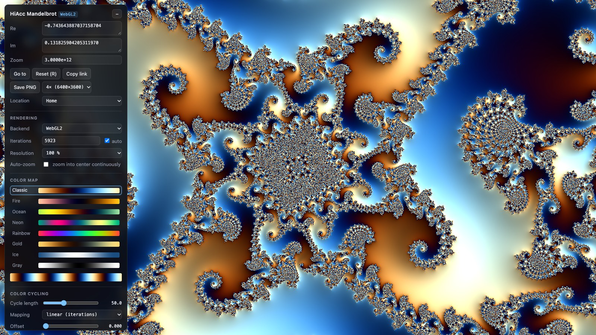

# HiAcc Mandelbrot

A deep-zoom Mandelbrot explorer that runs in the browser. It renders with WebGPU and falls back to WebGL2. Using perturbation theory, it reaches about 10³⁰× magnification on a GPU that only computes in 32-bit floats.



## Running

The whole application is the single file `index.html`. There are no dependencies and no build step.

```sh
python3 -m http.server 8931
# open http://localhost:8931/index.html
```

Opening `index.html` directly from disk also works. Requirements:

- **WebGPU:** a browser with WebGPU support, such as Chrome, Edge or Safari 18+.
- **WebGL2 fallback:** WebGL2 with `EXT_color_buffer_float`.

## Controls

| Action | Input |
|---|---|
| Pan | drag, arrow keys |
| Zoom | mouse wheel / pinch (centered on the cursor), `+` / `−` |
| Zoom ×4 in / out | double-click / shift + double-click |
| Reset view | `R` |
| Hide panel | `H` |
| Start / stop color cycling | `C` |
| Cancel PNG export | `Esc` |

In the panel you can:
- Enter coordinates as arbitrary-length decimal numbers, or pick a preset location.
- Choose the iteration limit (automatic or manual), the backend and the render resolution.
- Use auto-zoom.

## URL parameters

- `#re=…&im=…&h=…` sets the view center and the visible height `h` (magnification = 3 / h). **Copy link** writes the current view into this hash.
- `?gl` forces the WebGL2 backend.

Example: `index.html#re=-0.743643887037158704752191506114774&im=0.131825904205311970493132056385139&h=1e-12`

## Coloring

- **Color maps:** 8 cosine palettes, each shown as a preview strip. A second strip shows the active mapping with the current offset.
- **Color cycling:**
  - **Cycle length:** iterations per color cycle, from 2 to 16384.
  - **Mapping:** linear, square root or logarithmic.
  - **Offset:** shifts the colors along the cycle.
  - **Speed:** animated cycling, from −2 to +2 cycles per second.
- **Relief:** surface shading computed from the derivative dz/dc, with adjustable strength, light angle and light height.

Changes to coloring and relief only re-run the coloring pass, so they apply instantly at any zoom depth.

## PNG export

**Save PNG** renders the current view at 1×, 2× or 4× the screen resolution. This is a full re-render at the target size, not an upscale. The image is computed in 2048 × 2048 chunks and assembled in a 2D canvas. Output size is limited to about 250 megapixels by browser canvas limits.

## How it works

- **View center:** stored as a BigInt fixed-point number with 320 fractional bits.
- **Reference orbit:** a Web Worker computes the orbit of the view center with BigInt arithmetic, at a precision of the zoom depth plus 64 bits.
- **Per-pixel iteration:** each pixel iterates only its float32 offset from the reference, δz ← 2·Z·δz + δz² + δc. When |z| becomes smaller than |δz|, or the reference orbit ends, the pixel restarts on the reference ("rebasing", after Zhuoran). This removes the glitches of classic perturbation rendering without needing several reference points.
- **Two GPU passes:**
  1. Writes the smooth iteration count and surface normal to a 32-bit float texture.
  2. Colorizes that texture.
- **Tiled rendering:** the iteration pass is drawn in 128 px tiles with one GPU submission per tile, starting at the center. This keeps every command buffer short enough to stay under the operating system's GPU watchdog.

## Limits

- **Maximum magnification:** about 10³⁰, where the float32 per-pixel offsets reach the end of their normal range. Going deeper would need an extended-exponent float format on the GPU.
- **Iteration limit:** very deep views need high iteration limits. If areas render black, raise the limit manually.
